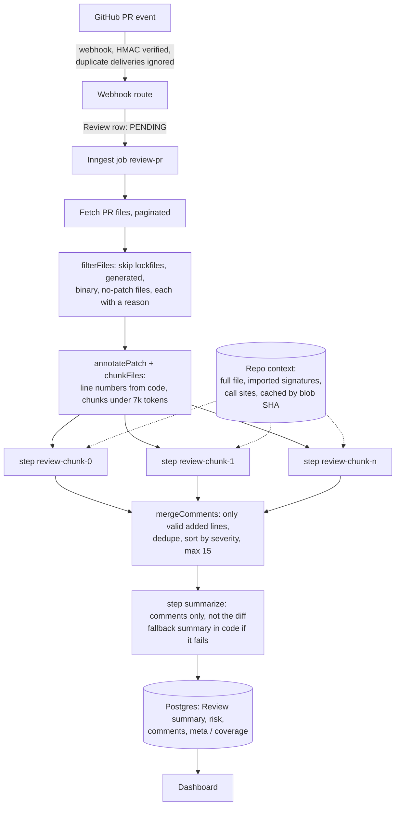

# GitPrReviewer

An AI reviewer for GitHub pull requests. Connect a repository, and every time a PR is opened or updated it reviews the diff, using code from the rest of the repo as context, and shows a summary, a risk score and line-level comments in a dashboard.

The interesting part isn't the model call. It's everything around it: splitting large PRs so nothing gets buried, putting line numbers in from code instead of trusting the model, handling one bad model reply without losing the whole review, giving the model the right slice of the repo under a token budget, and an eval harness that measures all of it.

**Stack:** Next.js 16, React 19, TypeScript, tRPC, Prisma + PostgreSQL, better-auth (GitHub OAuth), Inngest for background jobs, Gemini (`gemini-3.1-flash-lite`) through the OpenAI SDK, Vitest.

## How it works



The review logic in `src/server/review/` is pure: it takes data in and returns data, and the model, GitHub and Inngest are passed in as plain functions (`llm`, `ContextProvider`, `runStep`). The same code runs in production and in the evals, and it's unit-tested without network or database.

### Large PRs
- **Filter first.** Lockfiles, generated files (by path or a "generated" header), binaries and files with no patch are skipped. Every skipped file is listed with its reason, both in `Review.meta` and in the UI's Coverage line, never silently.
- **Line numbers from code.** Each patch is annotated as `+ 45 | code` (added), `  46 | code` (context) or `-    | code` (deleted). The model copies the number, and any comment not on a real added line is dropped.
- **Chunks under a token budget.** Files are packed in PR order into chunks of at most `CHUNK_TOKEN_BUDGET` (7,000 estimated tokens); a file too big for one chunk is split at hunk boundaries.
- **One Inngest step per chunk, in parallel,** with at most 3 steps per user at once. A rate-limited chunk is retried alone; finished chunks aren't paid for again.
- **One bad chunk doesn't fail the review.** Broken JSON gets one more try; after that only that chunk is marked failed, and the summary says "1 of 3 parts could not be reviewed".
- **Merge and summarise.** Comments are de-duplicated, sorted by severity and capped at 15. A small extra call writes the summary and risk score from the comments alone.

### Repo context
For each chunk, `buildChunkContext()` collects, in priority order and cut from the bottom when over `CONTEXT_TOKEN_BUDGET` (4,000):
1. the changed file as it is after the PR (or the changed declarations ±20 lines if it's over 400 lines);
2. exported signatures of the files it imports (relative imports, one level, via the TypeScript compiler API);
3. up to 5 call sites of exported symbols the diff changed.

It goes into the prompt as `## REFERENCE ONLY`. In production it comes from GitHub at the PR's head commit: one tree request, then blobs by SHA, cached in Postgres by `(repo, blobSha)` so unchanged files are never downloaded twice. Call sites come from GitHub code search. Any failure only drops that piece of context.

## Results

Measured with the eval harness in `evals/`: one fixture repo and 30 PR diffs with a known answer (21 planted single bugs, 4 cross-file "context" bugs, 1 large PR with a bug buried in it, 4 clean PRs). Each case runs 3 times with the reviewer at temperature 0. A bug counts as caught when a comment is in the same file within ±3 lines **and** an LLM judge (`gemini-3-flash-preview`) agrees it describes the planted bug; I hand-checked the judge's sampled decisions in every run.

| | v1 (one prompt) | v2, Phase 3 (chunked) | v2 without context | **v2 with context** |
|---|---|---|---|---|
| Cases × runs | 26 × 3 | 26 × 3 | 30 × 3 | 30 × 3 |
| Catch rate, all | 100% (66/66) | 95% (63/66) | 81% (63/78) | **88% (69/78)** |
| Cross-file bugs (4 cases) | – | – | 0/12 | **9/12** |
| Large PR: bug caught | 3/3 | 3/3 | 3/3 | 3/3 |
| Large PR: prompt tokens per review | 40,141 | **9,840** | – | – |
| Noise comments per PR | 0.23 | 0.27 | 0.30 | 0.30 |
| High/critical false alarms on clean PRs | 0/12 | 0/12 | 0/12 | 0/12 |
| Failed reviews | 0/78 | 0/78 | 0/90 | 0/90 |
| Prompt tokens per PR | 2,562 | 1,693 | 1,634 | 2,572 |
| Median latency | 2.94s | 3.14s | 7.04s* | 3.01s |

Sources: `evals/results/*-v1-baseline.score.md`, `*-v2-phase3.score.md`, `*-p4-no-context.score.md`, `*-p4-context.score.md`. The v1 and Phase 3 runs don't include the 4 context cases, so compare the "all" catch rate only within the same column pair.

What the numbers say:
- **Repo context works on what it was built for:** cross-file bugs (swapped arguments, a function made `async` without its callers awaiting it, dollars vs. cents) go from never caught to caught in every run. The fourth, a new `null` return, is missed both ways.
- **Large PRs got 75% cheaper** (the lockfile alone was two thirds of v1's prompt), and the buried bug is still caught.
- **v1 was already strong on simple single-bug PRs**, and v2 did not improve that: it misses one race-condition case (`race-03`) in every run. With context, one more race case is counted as missed although the comment is correct; it lands 5 lines from the marked bug line, outside the ±3 window (details in `GUIDE.md`).
- **Context costs** 57% more prompt tokens per PR and makes the model add medium-severity comments to clean PRs (6 across 12 clean reviews, none high/critical).
- *The no-context run was 19 hours after the others and hit 13 rate-limit retries; compare latency only between runs made close together.

## Running it

```bash
npm install
cp .env.example .env        # DATABASE_URL, GEMINI_API_KEY, GitHub OAuth + webhook secret, Inngest keys
npx prisma migrate deploy
npm run dev                 # app on http://localhost:3000
npx inngest-cli@latest dev  # Inngest dev server, in another terminal
```

Checks: `npm run lint`, `npx tsc --noEmit`, `npm run test`.

### Running the evals

```bash
npm run eval -- --label my-change                 # all cases, 3 runs each
npm run eval -- --runs 1 --only sqli-,ob-01       # quick subset by id prefix
npm run eval -- --no-context --label diff-only    # without repo context
npm run eval:score                                # score the newest run
```

Results go to `evals/results/` (`.json` raw, `.score.md` report). The judge uses `JUDGE_API_KEY` if set (a key from another Google project gives it its own free-tier quota), and verdicts are cached in `evals/results/judge-cache.json`. See `evals/README.md`. `evals/planted-bugs/` is the older harness that ran the reviewer on real PRs in a GitHub test repo and labelled every comment by hand.

## Limitations

- **Small eval set.** 30 short cases written for this project, one reviewer model, three runs at temperature 0 (so runs mostly repeat each other). One case flipping moves the catch rate by 4 points. The numbers show direction, not precision.
- **The judge is a model too.** It's checked by hand on a sample each run, not on every decision. The ±3-line location window can reject a correct comment placed a few lines away (it did once).
- **Context is TypeScript/JavaScript only** for signatures, follows only relative imports one level deep (path aliases like `@/` aren't resolved), and call sites come from GitHub code search, which only searches the default branch and is limited to 10 requests per minute.
- **A bug that spans two chunks** can still be missed if context doesn't cover it.
- **Free-tier Gemini limits** (500 requests/day for the reviewer model, 20/day for preview models) shaped how often the evals could run.
- **Deploy files are out of date:** the `Dockerfile` and `.github/workflows/deploy-vps.yml` still use pnpm (there is no `pnpm-lock.yaml`) and `OPENAI_API_KEY`; they need updating to npm and `GEMINI_API_KEY` before deploying.
- The `ContextCache` table grows over time; there's no cleanup job yet.

## Docs
- `GUIDE.md`: what was built in each phase, how it works, how to test it, results and interview Q&A.
- `DECISIONS.md`: every design decision with the options, the choice, the tradeoff and when to revisit.
- `CLAUDE.md`: rules for working on this codebase.
